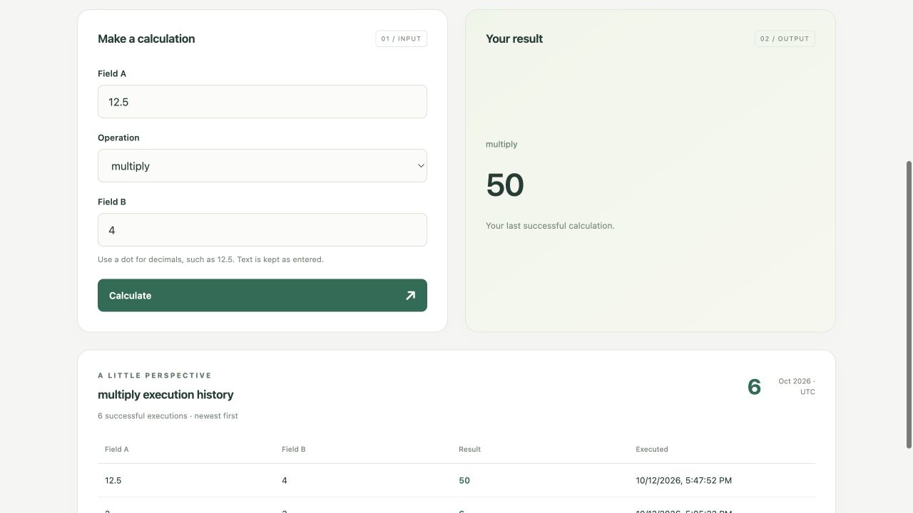
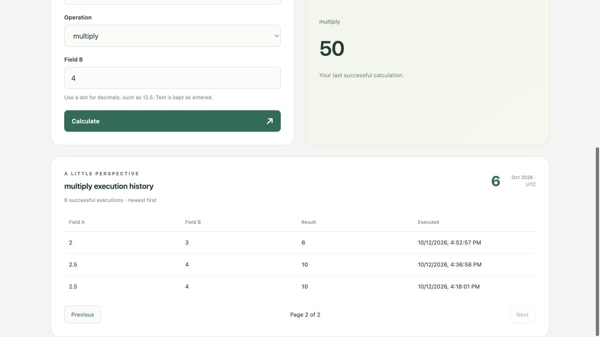

# Gaia

A small ASP.NET Core 9 and React application with six operations: **Add, Subtract, Multiply, Divide, Concat, and Compare**. Successful executions are saved in Oracle with paginated history (three results per page by default) and a current-month count.

## Screenshots

**Calculate with numbers or text.** Choose an operation and enter two values. Here, `12.5 × 4` returns `50`; the successful execution is saved to Oracle. The last result stays visible while the next calculation is running.



**Browse saved executions.** History shows three records per page, with Previous/Next controls and the total number of pages. The counter at the top right shows successful executions for the displayed UTC month. This example shows page 2 of 2.



## Run locally

Prerequisites: .NET 9 SDK, Node.js 20.18+ with npm, and Docker Desktop. The included official Oracle Database Free image runs natively on **macOS Apple Silicon**, without x86 emulation. Allow Docker at least 4 GB of memory and several GB of free disk space.

From the repository root:

```sh
cp .env.example .env
```

For a new installation, choose both passwords yourself and enter them between the quotes in `.env`. You do not obtain these values from Oracle, and no Oracle account or cloud subscription is needed. They become the passwords for your local database when it is initialized. Use 12–64 letters, digits or underscores, starting with a letter. The file is ignored by Git; never commit credentials.

- `ORACLE_PWD`: choose a new password for the administrative users of your local Oracle database. Docker uses it during the first database initialization. This is not an existing Oracle website account password.
- `ORACLE_APP_PASSWORD`: choose a new password for the local `GAIA` database user used by the API. The startup script creates this user automatically if it does not exist, using your chosen password; no manual user creation is needed.

If the database is already initialized, keep the existing passwords in `.env`; do not replace them with new arbitrary values. Editing `.env` alone does not update passwords stored in the existing database.

Start Oracle, then the API:

```sh
docker compose up -d --wait
set -a
source .env
set +a
dotnet run --project src/Gaia.Api --launch-profile http
```

The first Oracle startup can take several minutes. Docker Compose reads `.env` automatically; the API does not. Run `set -a`, `source .env`, and `set +a` in the same terminal as `dotnet run`, repeating these steps whenever you open a new API terminal. The API connects as `GAIA` using `ORACLE_APP_PASSWORD`. The startup script creates the application user and tablespace, and the API applies EF migrations automatically in Development.

In another terminal, from the repository root:

```sh
cd frontend
npm ci
npm run dev
```

Open **http://127.0.0.1:5173**. Vite proxies `/api` to **http://localhost:5235**. Local development uses HTTP without development certificates.

`docker compose down` stops Oracle without deleting the `gaia_oracle-data` volume. Resume with `docker compose up -d --wait`. Changing `ORACLE_APP_PASSWORD` in `.env` does not change the existing database user's password. Inspect initialization failures with `docker compose logs oracle`.

## Operations and API

Arithmetic accepts signed decimal strings with a dot, without grouping separators or exponent notation. Parsing and results use invariant culture and .NET decimal precision. Overflow and division by zero return validation errors. Concat joins text directly; Compare returns whether the two strings are equal using ordinal, case-insensitive comparison. Text is not trimmed.

Both inputs are required and limited to 1,000 characters. Empty strings are valid for text operations. Values travel as strings so JavaScript does not round decimal results.

| Method | Route | Purpose |
|---|---|---|
| GET | `/api/v1/operations` | Available operations |
| POST | `/api/v1/operations/execute` | Calculate, save, and return history/statistics |
| GET | `/api/v1/operations/{code}/history?page=1&pageSize=3` | One page of executions, pagination totals, and monthly count |

```sh
curl http://localhost:5235/api/v1/operations
curl -X POST http://localhost:5235/api/v1/operations/execute \
  -H 'Content-Type: application/json' \
  -d '{"operationCode":"divide","fieldA":"7","fieldB":"2"}'
curl 'http://localhost:5235/api/v1/operations/divide/history?page=1&pageSize=3'
```

Responses use `ApiResponse<T>`: `{ success, data, error }`. The operations endpoint returns an array of codes, such as `["add", "subtract", "multiply", "divide", "concat", "compare"]`. The frontend displays these codes and uses plain text inputs; each strategy validates its own inputs. Execution data contains `operationCode`, `result: "3.5"`, and `history: { items, page, pageSize, totalCount, totalPages, currentMonthCount, monthStartUtc }`. All results are strings, including text and `"true"` / `"false"`. History entries use the same string result.

History defaults to `page=1&pageSize=3`. Pages start at 1; page sizes from 1 to 50 are accepted. Invalid values or offsets above `Int32.MaxValue` return 400. A page beyond the available history returns an empty `items` array; no history means `totalCount=0` and `totalPages=0`. Counts cover all matching executions, not just the current page. The database applies `Skip`/`Take` before loading rows. The execute response includes the first page; Previous/Next fetch subsequent pages from the history endpoint. Each new calculation starts again at page 1. The monthly count displays the UTC month returned by the server.

Pagination uses a simple live view, not a frozen snapshot: executions added by another client between page requests can shift rows across page boundaries.

The last successful result and history stay visible while editing inputs or waiting for a calculation, and remain available if it fails. A successful response replaces them and resets history to page 1. This avoids collapsing the history section and moving the scroll position during a request.

Invalid requests return **400** with `VALIDATION_ERROR`, `INVALID_NUMBER`, `NUMBER_OUT_OF_RANGE`, `DIVISION_BY_ZERO`, or `OPERATION_NOT_SUPPORTED`. Unknown history operations return **404**. Database failures return **503 / DATABASE_UNAVAILABLE**; unexpected exceptions return **500 / INTERNAL_SERVER_ERROR**. Errors expose no exception details.

## Add or remove operations

The six operations are C# classes implementing `IOperation`, registered explicitly in `src/Gaia.Api/Program.cs`. Each class defines only its code and calculation. `OperationService` receives the registered implementations directly through `IEnumerable<IOperation>`. There are no operation settings in `appsettings.json`.

To add a new behavior, implement `IOperation` and register the class. For example, after implementing `MaximumOperation`:

```csharp
builder.Services.AddSingleton<IOperation, MaximumOperation>();
```

To remove an operation from the API and UI, remove its DI registration. Change its behavior in its implementation. Restart the API and refresh the browser after changes. No edits to `OperationService`, controllers, frontend, or database schema are needed.

Numeric operations can reuse `DecimalCalculation.Execute(a, b, calculation)` for shared parsing and arithmetic error handling. Operation codes identify saved history.

## Structure and persistence

- **Gaia.Application:** six small strategies, `OperationService`, shared decimal handling, `Result<T>`, and string results.
- **Gaia.Api:** controllers and DTOs, DI/configuration, exception handling, logging, and `ExecutionHistoryService` using `GaiaDbContext` directly.
- **frontend:** `App` provides the layout and renders `OperationsPage`. The page holds the execution shared by the result and history components. `OperationForm` owns its inputs, loading/error state, and API calls, notifying the page when the execution changes. `main.tsx` mounts the app.

There are no factories, repositories, reflection-based registration, or expression/template engines.

Oracle uses one DbContext, one migration set, and one application table. Successful requests save and read their first history page in a transaction. History is grouped by stable operation code and ordered by UTC timestamp descending and then ID descending. Monthly counts use `[UTC month start, next UTC month start)` across all users.

Oracle empty text is read back as an empty string. Results use NCLOB; timestamps retain UTC semantics and seven fractional digits. Existing stored rows are retained, including rows for operations no longer offered by the API.

HTTP logging records method, path, status, and duration. Request bodies and credentials are excluded; unexpected errors are logged server-side.

## Build and migrations

```sh
dotnet build Gaia.sln
npm --prefix frontend ci
npm --prefix frontend run build
```

After changing the EF model, export `.env` as above, then:

```sh
dotnet tool restore
dotnet ef migrations add YourChange --project src/Gaia.Api --output-dir Data/Migrations
dotnet ef database update --project src/Gaia.Api
```

To publish the API with the built React assets:

```sh
npm --prefix frontend run build
dotnet publish src/Gaia.Api -c Release -o artifacts/publish
```

Outside Development, apply migrations explicitly. `ORACLE_DATA_SOURCE` optionally overrides `localhost:1521/FREEPDB1`. Production hosting/TLS configuration is deployment-specific.

## Scope and verification

Automated testing infrastructure is intentionally omitted. This is a take-home demonstration without authentication, retention policies, or idempotent retries. The database is required for successful execution responses. Only the Apple Silicon setup has been verified; Intel/Windows and production deployment are outside the verified scope.

Manual verification after this simplification:

- .NET build passed with zero warnings/errors; React production build passed.
- All six operations executed against real Oracle, including persisted empty/Unicode text and decimal results.
- Last-three ordering, monthly counts, canonical operation codes, and persistence after an Oracle restart passed.
- Invalid requests did not add history.
- Browser checks confirmed exactly six options, successful calculation/history/statistics through Vite, and validation errors.
- A deliberate Oracle outage returned a safe 503 response. HTTP logging and the absence of obsolete dependencies/configuration were checked.

Pagination verification: both builds passed. 55 read-only API checks against Oracle covered every operation's pages, row ordering, non-overlap, totals, partial and out-of-range pages, custom page sizes, invalid parameters, and offset overflow. Browser checks covered Next/Previous, the disabled Previous button on page 1, and resetting to page 1 after a new calculation. Temporary browser-test rows were removed afterwards.
